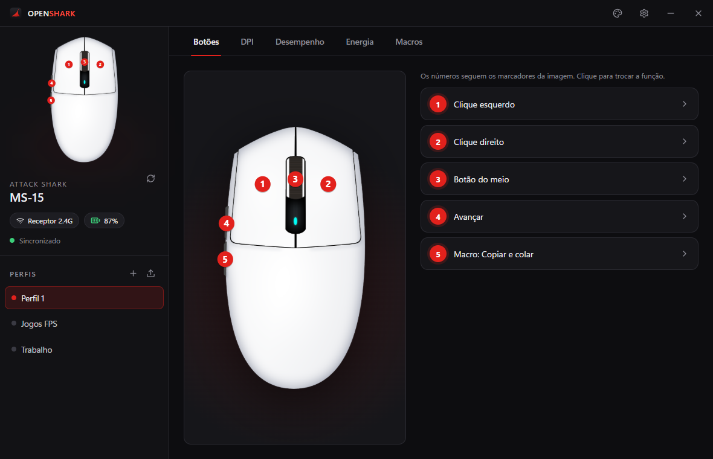
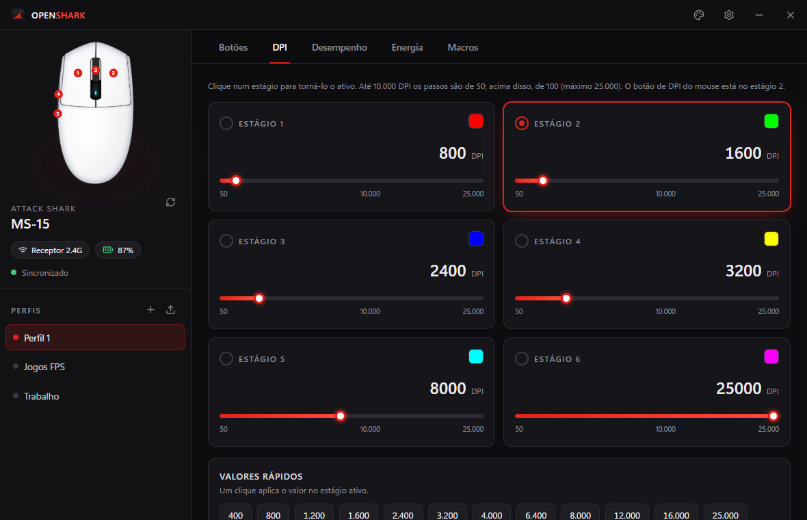
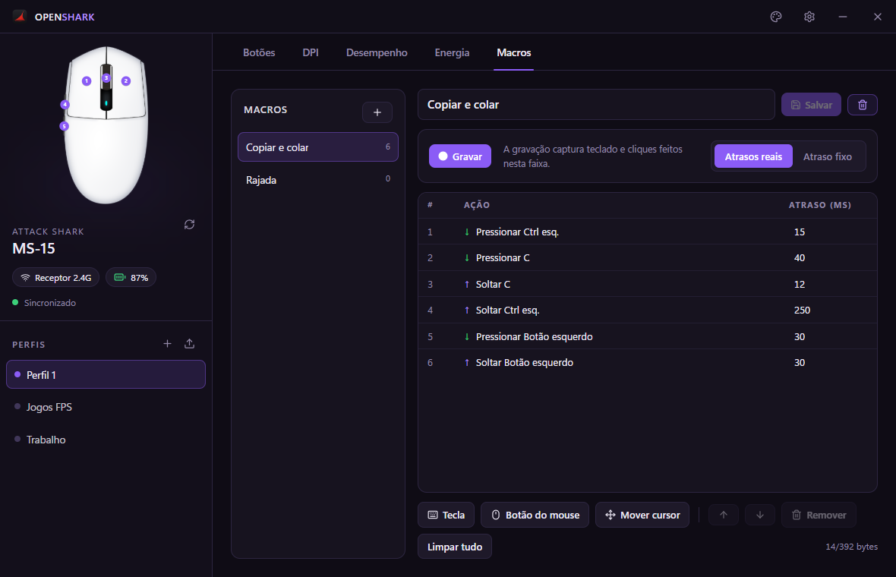
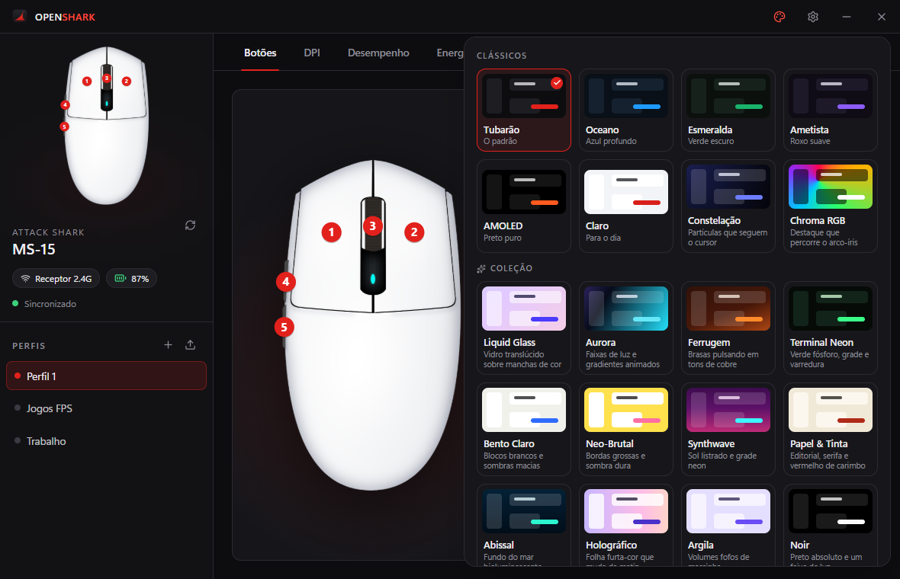

# OpenShark

Configurador **não oficial** e de código aberto para mouses Attack Shark que usam o receptor 2.4G
`1D57:FA60`, feito em Rust (Tauri 2) com interface em React.



> Projeto independente, sem vínculo com a Attack Shark. "Attack Shark" é marca da respectiva
> fabricante e aparece aqui só para indicar compatibilidade. Use por sua conta e risco.

## O que faz

- **Botões**: funções de mouse, DPI, multimídia, navegador, atalhos do Windows, atalho personalizado e macro.
- **DPI**: até 6 estágios de 50 a 25.000 DPI, com cor por estágio; acompanha a troca feita no botão do mouse.
- **Desempenho**: taxa de polling (125 a 1000 Hz), controle de ondulação, correção de linha e tempo de resposta.
- **Energia**: bateria e carregamento, tempo de sono e de sono profundo.
- **Macros**: gravação de teclado e botões do mouse, editor de eventos e modos de repetição.
- **Perfis**: criar, duplicar, renomear, restaurar o padrão, importar e exportar.
- **Bandeja**: a barbatana do ícone muda de cor conforme a bateria (vermelho vazia, verde cheia); a porcentagem aparece na dica.
- **Temas**: 33 temas, dos simples aos animados.

Se o mouse estiver dormindo, as mudanças ficam salvas e são enviadas quando ele acordar.

| DPI | Macros | Temas |
| --- | --- | --- |
|  |  |  |

As capturas usam dados de demonstração.

## Estado do projeto

Versão 0.1.0, para Windows 10 e 11. O que já foi conferido num mouse real (MS-15, pelo receptor):

| Função | Situação |
| --- | --- |
| Detecção, bateria e aviso de troca de DPI | conferido |
| Leitura de DPI e energia | conferido |
| Envio de DPI, energia e polling | conferido (o mouse confirma o recebimento) |
| Troca de função dos botões | implementado, **sem confirmação em hardware** |
| Macros | implementado, **sem confirmação em hardware** |
| Polling acima de 1000 Hz (receptor 4K/8K) | não suportado |

## Modelos

O receptor informa qual mouse está do outro lado por um código; o app conhece 18, numerados `MS-1` a
`MS-18` porque o nome comercial de cada um ainda não foi mapeado.

| Situação | Modelos |
| --- | --- |
| Testado em hardware | MS-15 |
| Gravação habilitada, mesmo formato do MS-15, **sem teste em hardware** | MS-11, MS-14, MS-16, MS-17, MS-18 |
| Só detecção (bateria e conexão); edição bloqueada | os outros 12 |

Tabela completa, com códigos e recursos, em [docs/MODELOS.md](docs/MODELOS.md). Relatos de teste em
outros modelos são bem-vindos.

## Usar

Ainda não há instalador publicado: é preciso compilar (abaixo). Depois, abra `openshark.exe` com o
receptor no USB e mexa o mouse para ele se identificar. Feche o programa oficial da fabricante antes,
para os dois não disputarem o mouse. O passo a passo de cada aba está em [docs/GUIA.md](docs/GUIA.md).

## Compilar

Requisitos: Rust estável, Node.js com pnpm e, no Windows, o WebView2 (já vem no Windows 11).

```powershell
pnpm --dir ui install
pnpm --dir ui build
cargo build --release -p shark-app --features tauri/custom-protocol
```

O executável sai em `target/release/openshark.exe`.

```powershell
cargo test --workspace                       # testes do protocolo e do ícone da bandeja
cargo run -p shark-device --example probe    # diagnóstico só de leitura
pnpm --dir ui dev                            # interface no navegador, com dados simulados
```

## Documentação

| Documento | Conteúdo |
| --- | --- |
| [docs/GUIA.md](docs/GUIA.md) | Como usar cada aba, perfis, bandeja e problemas comuns |
| [docs/MODELOS.md](docs/MODELOS.md) | Os 18 modelos, o que cada situação significa e como ajudar a mapear |
| [docs/TEMAS.md](docs/TEMAS.md) | Lista dos temas e como criar um |
| [docs/ARQUITETURA.md](docs/ARQUITETURA.md) | Como o código está organizado e como habilitar um modelo novo |
| [docs/PROTOCOLO.md](docs/PROTOCOLO.md) | Formato dos pacotes HID |
| [CONTRIBUTING.md](CONTRIBUTING.md) | Como relatar testes e contribuir com código |

## Estrutura

- `crates/proto` — protocolo puro: modelos, perfis, codificação e decodificação dos pacotes, macros.
- `crates/device` — HID: detecção do receptor ou do cabo, eventos (bateria, DPI, confirmações), envio e leitura.
- `src-tauri` — o app: perfis e macros em `%APPDATA%\OpenShark\dados.json`, envio só do que mudou, bandeja.
- `ui` — React 19 + Vite + Tailwind 4.

## Perguntas frequentes

**Substitui o programa oficial?** Para os modelos com gravação habilitada, cobre botões, DPI, polling,
energia, macros e perfis. Não atualiza firmware nem configura iluminação nos modelos suportados hoje
(eles não têm).

**Pode estragar o mouse?** O app só manda os mesmos tipos de pacote de configuração, e a edição fica
bloqueada nos modelos cujo formato não foi verificado. Mesmo assim, é um projeto não oficial e sem
garantia; "Restaurar padrão" devolve os valores de fábrica do perfil.

**Funciona em Linux ou macOS?** O código de HID e a interface são portáveis, mas só o Windows foi
compilado e testado.

**Meus dados vão para algum lugar?** Não. O app não usa rede; perfis e macros ficam só no seu computador.

## Licença

[MIT](LICENSE).
