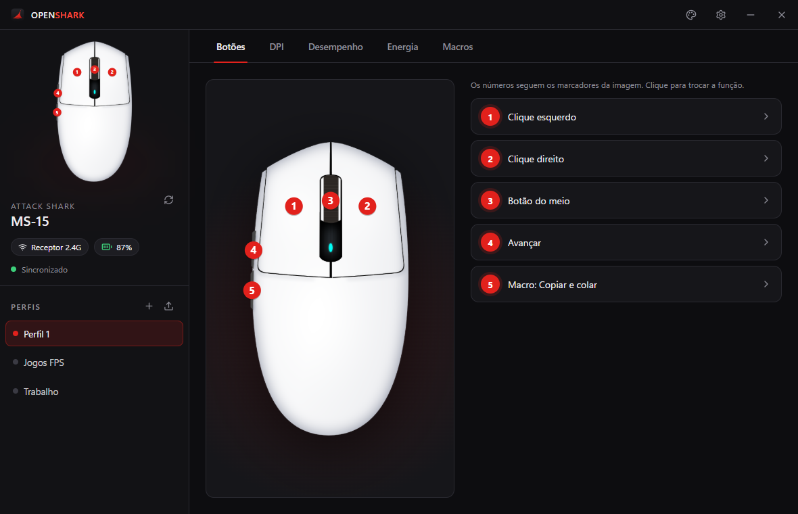
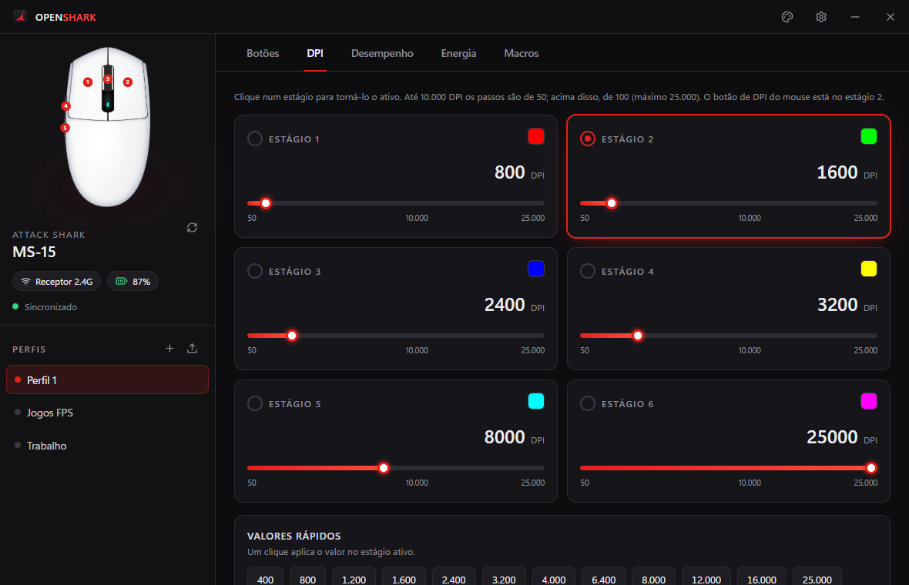
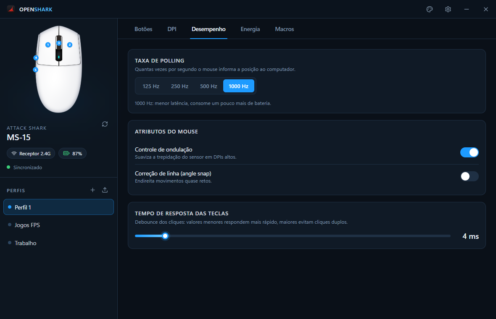
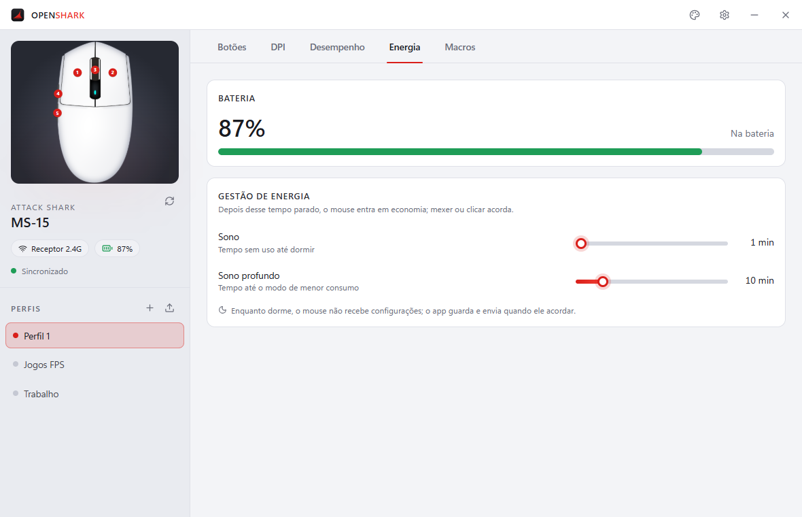
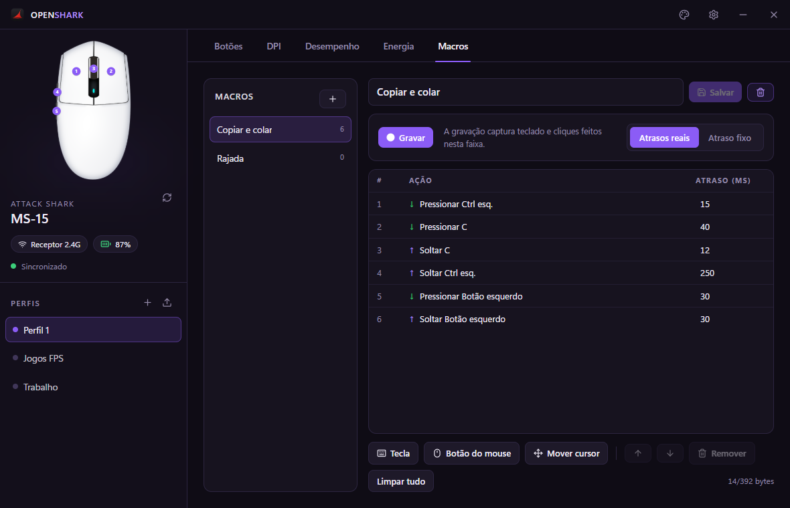
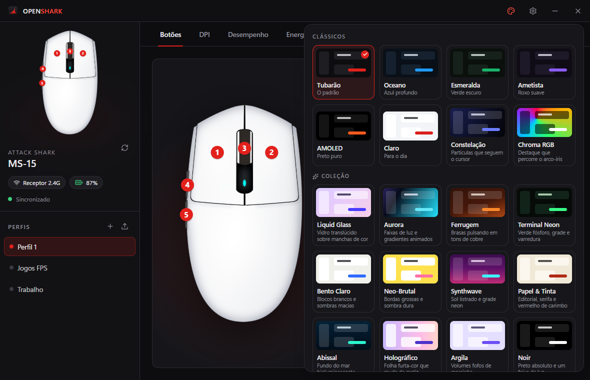

# Guia de uso

As capturas desta página usam dados de demonstração.

## Conexão

Abra o OpenShark com o receptor 2.4G no USB (ou o mouse no cabo). O app procura o mouse sozinho:

- **Receptor encontrado, mouse não identificado**: mexa o mouse. Ele só se identifica quando está acordado.
- **Dormindo**: o mouse parou de responder por economia de energia. As mudanças que você fizer ficam
  salvas e são enviadas assim que ele acordar; o painel lateral mostra "Mudanças aguardando o mouse acordar".
- **Sincronizado**: o que está na tela é o que está no mouse.

Ao conectar, o app lê do mouse o DPI e a energia e atualiza o perfil ativo (a leitura da taxa de polling
ainda não foi confirmada; nela vale o que está salvo). O
botão de recarregar, ao lado do nome do modelo, repete essa leitura. As funções dos botões não podem
ser lidas do mouse: vale o que está salvo no perfil.

## Botões

Clique num botão da lista para trocar a função. As funções estão em grupos: mouse, DPI, multimídia,
navegador, sistema, atalhos do Windows e especiais.

- **Atalho personalizado**: pressione a combinação de teclas (ou marque Ctrl, Shift, Alt, Win).
- **Macro**: escolha uma macro da biblioteca e como ela se repete (número de vezes, até apertar uma
  tecla, ou enquanto o botão estiver pressionado).
- Pelo menos um botão precisa continuar sendo "Clique esquerdo".

## DPI

Até 6 estágios. Clique num estágio para torná-lo o ativo; arraste o controle ou digite o valor.
De 50 a 10.000 DPI os passos são de 50; de 10.000 a 25.000, de 100. Cada estágio tem uma cor, e os
"valores rápidos" aplicam um valor comum no estágio ativo. Se você trocar o estágio no botão do
mouse, o app acompanha.

## Desempenho

- **Taxa de polling**: 125, 250, 500 ou 1000 Hz. Taxas maiores pedem o receptor 4K/8K, que ainda não é suportado.
- **Controle de ondulação**: suaviza a trepidação do sensor em DPIs altos.
- **Correção de linha** (angle snap): endireita movimentos quase retos.
- **Tempo de resposta das teclas**: de 2 a 25 ms. Menor responde mais rápido; maior evita cliques duplos.

Motion sync e distância de levantamento só aparecem nos modelos que têm esses recursos.

## Energia

Mostra a bateria (pelo receptor; no cabo o mouse não informa) e ajusta o tempo até o sono e até o
sono profundo, de 1 a 60 minutos.

## Macros

1. Crie uma macro com o botão **+**.
2. Clique em **Gravar** e digite no teclado; para gravar cliques, clique na faixa de gravação com os
   botões do mouse. Escolha entre guardar os atrasos reais ou usar um atraso fixo.
3. Ajuste a lista: edite atrasos, mova, remova ou insira teclas, botões do mouse e movimentos do cursor.
4. **Salvar**. Para usar, atribua a macro a um botão na aba Botões.

O contador no canto mostra quanto a macro ocupa no mouse (até 392 bytes); o que passar disso é cortado.

## Perfis

No painel lateral: criar, ativar, renomear, duplicar, exportar, restaurar o padrão e excluir. Ativar
um perfil envia a configuração inteira para o mouse. Perfis exportados (`.sharkprofile`) levam junto
as macros que os botões usam.

Os perfis são guardados por modelo, em `%APPDATA%\OpenShark\dados.json`.

## Bandeja e inicialização

O ícone da bandeja é uma barbatana que muda de cor conforme a bateria: vermelho quando vazia, verde
quando cheia, azul carregando e esmaecida com o mouse dormindo. A porcentagem aparece ao passar o
cursor. Nas configurações (engrenagem) dá para iniciar com o Windows e escolher se o **X** fecha o
app ou só o esconde na bandeja.

## Temas

O ícone de paleta abre os 33 temas. Veja a lista em [TEMAS.md](TEMAS.md).

## Problemas comuns

| Sintoma | O que fazer |
| --- | --- |
| "Procurando o mouse…" e nada acontece | Confira o receptor no USB e o botão de energia embaixo do mouse. Feche o programa oficial da fabricante, se estiver aberto. |
| Receptor encontrado, mas o modelo não aparece | Mexa o mouse; ele se identifica em até 2 segundos quando acordado. |
| "O mouse não confirmou" | O mouse dormiu ou saiu do alcance. Mexa-o; a mudança fica salva e é reenviada. |
| A edição está bloqueada | O modelo está em "só detecção". Veja [MODELOS.md](MODELOS.md). |
| A bateria não aparece | No cabo ela não é informada; pelo receptor, aguarde alguns segundos com o mouse acordado. |
