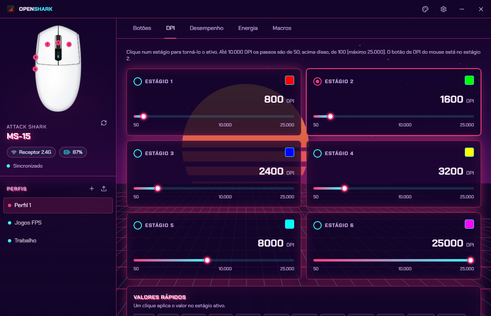
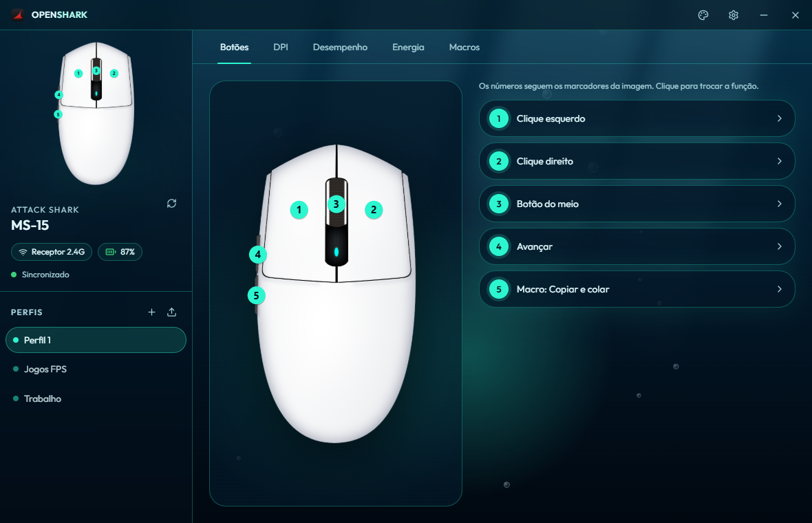
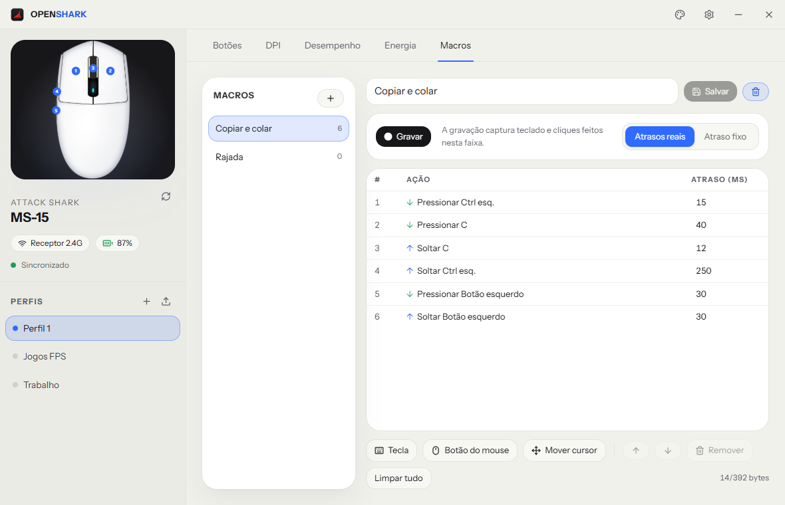

# Temas

O OpenShark tem 33 temas, escolhidos pelo ícone de paleta na barra de título. A troca abre o
tema novo em círculo a partir do clique, e a escolha fica salva. Se o Windows estiver com os efeitos
de animação desligados, os cenários ficam parados.

| | | |
| --- | --- | --- |
|  |  |  |

## Clássicos

| Tema | Descrição | Claro | Cenário animado |
| --- | --- | --- | --- |
| **Tubarão** (`shark`) | O padrão | — | — |
| **Oceano** (`ocean`) | Azul profundo | — | — |
| **Esmeralda** (`emerald`) | Verde escuro | — | — |
| **Ametista** (`amethyst`) | Roxo suave | — | — |
| **AMOLED** (`amoled`) | Preto puro | — | — |
| **Claro** (`light`) | Para o dia | — | — |
| **Constelação** (`constellation`) | Partículas que seguem o cursor | — | sim |
| **Chroma RGB** (`chroma`) | Destaque que percorre o arco-íris | — | sim |

## Coleção

Cada tema da coleção tem as próprias cores, fontes, raios de borda, estilo de botões e cartões e,
quase sempre, um cenário atrás da interface.

| Tema | Descrição | Claro | Cenário animado |
| --- | --- | --- | --- |
| **Liquid Glass** (`glass`) | Vidro translúcido sobre manchas de cor | sim | sim |
| **Aurora** (`aurora`) | Faixas de luz e gradientes animados | — | sim |
| **Ferrugem** (`ferrugem`) | Brasas pulsando em tons de cobre | — | sim |
| **Terminal Neon** (`terminal`) | Verde fósforo, grade e varredura | — | sim |
| **Bento Claro** (`bento`) | Blocos brancos e sombras macias | sim | sim |
| **Neo-Brutal** (`brutal`) | Bordas grossas e sombra dura | sim | sim |
| **Synthwave** (`synthwave`) | Sol listrado e grade neon | — | sim |
| **Papel & Tinta** (`papel`) | Editorial, serifa e vermelho de carimbo | sim | sim |
| **Abissal** (`abissal`) | Fundo do mar bioluminescente | — | sim |
| **Holográfico** (`holo`) | Folha furta-cor que muda de matiz | sim | sim |
| **Argila** (`argila`) | Volumes fofos de massinha | sim | sim |
| **Noir** (`noir`) | Preto absoluto e um feixe de luz | — | sim |
| **Musgo** (`musgo`) | Formas orgânicas em verde e terracota | sim | sim |
| **Blueprint** (`blueprint`) | Planta de engenharia em cianótipo | — | sim |
| **Déco** (`deco`) | Preto e ouro com raios girando | — | sim |
| **Gelo** (`gelo`) | Cristal azul-claro e neve caindo | sim | sim |
| **Pixel** (`pixel`) | 8 bits: blocos, pixels e saltos | — | sim |
| **Memphis** (`memphis`) | Anos 80: formas soltas e bolinhas | sim | sim |
| **Relevo** (`relevo`) | Neumorfismo: tudo em alto-relevo | sim | sim |
| **Cosmos** (`cosmos`) | Estrelas piscando e órbitas douradas | — | sim |
| **Mesh** (`mesh`) | Malha de cores vivas com folha branca | sim | sim |
| **Sakura** (`sakura`) | Pétalas caindo em rosa suave | sim | sim |
| **Turbo** (`turbo`) | Carbono, verde-limão e velocidade | — | sim |
| **Suíço** (`suico`) | Tipografia forte, preto, branco e vermelho | sim | sim |
| **Lousa** (`lousa`) | Giz colorido no quadro-verde | — | sim |

## Como criar um tema

1. Em `ui/src/theme.ts`, acrescente uma entrada em `THEMES` com `id`, nome, descrição e as cores da miniatura.
   Use `light: true` se for um tema claro e `scene: true` se tiver cenário.
2. Em `ui/src/themes.css`, crie o bloco `[data-theme="seu-id"]` com os tokens de cor
   (`--color-bg`, `--color-panel`, `--color-accent`, …), as fontes (`--font-sans`, `--font-display`)
   e os raios (`--radius-md` … `--radius-2xl`).
3. Opcional: estilize os componentes pelas classes `.card`, `.btn`, `.btn-primary`, `.seg`, `.tab`
   e desenhe o cenário nos oito elementos `.scene > i`.
4. `pnpm --dir ui dev` e abra `http://localhost:1440/?theme=seu-id` para ver com dados simulados.

Fontes novas entram pelo pacote `@fontsource/<nome>` e um `@import` em `ui/src/fonts.css`; assim
elas vão embutidas no app e funcionam sem internet.
